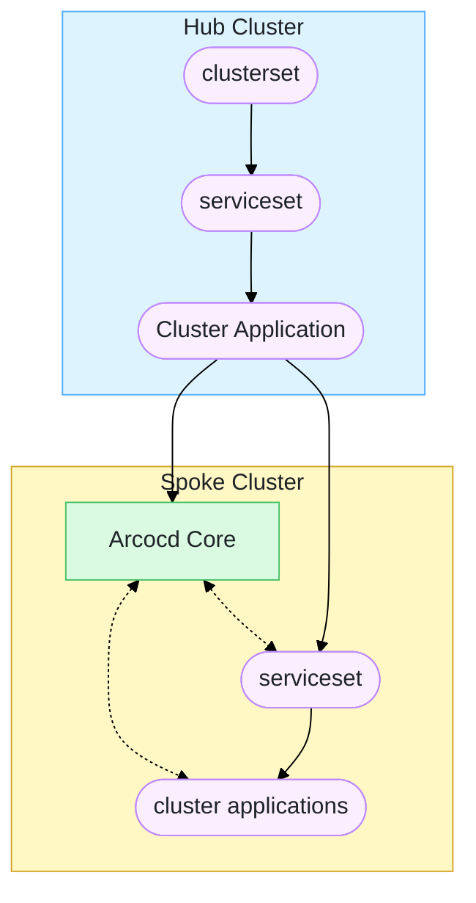

# Argo of Argos

This example demonstrate the use of Argo Flavors to manage multiple clusters where each cluster has its own argocd instance to ease the load from the main argocd. Instead of using argocd agent here we sync application manifests to the spoke clusters by deploying them with the main argocd



> [!NOTE]
> It is reccomended to use argocd agent with this project to get a cleaner deployment

# Environment set up
To deploy this example you will need an argocd instance connected to two clusters. The connected clusters don't have an argocd instance initially. If you don't already have an argocd instance, this part guides you through setting up a demo using vcluster.

## Requirements
- vcluster cli
- argocd cli
- kubectl
- a k8s cluster

### create vclusters
create vclusters and set up portforwarding.

set variables:
```shell
vcluster disconnect #just in case
MAIN_CTX=`kubectl config current-context`
MANAGER_NAME=hub
MANAGER_NS=vcluster-$MANAGER_NAME
ARGOCD_VERSION=v3.4.1
SPOKE_CLUSTERS_NAMES=(spoke0 spoke1)
SPOKE_CLUSTERS_NS=()
SPOKE_CLUSTERS_CONTEXTS=()
```

create workload clusters (wait patiently for vcluster):
```shell
for SPOKE_CLUSTER_NAME in ${SPOKE_CLUSTERS_NAMES[@]}; do
  SPOKE_CLUSTER_NS=vcluster-$SPOKE_CLUSTER_NAME
  SPOKE_CLUSTERS_NS+=($SPOKE_CLUSTER_NS)
  vcluster create --context $MAIN_CTX $SPOKE_CLUSTER_NAME -n $SPOKE_CLUSTER_NS --connect=false --upgrade \
    --set controlPlane.service.spec.type=ClusterIP
  SPOKE_CLUSTERS_CONTEXTS+=(`vcluster connect $SPOKE_CLUSTER_NAME -s -- kubectl config current-context`)
  vcluster connect --context $MAIN_CTX $SPOKE_CLUSTER_NAME --background-proxy=false -s &
done
```
create manager (wait patiently for vcluster):
```shell
# Attach spoke clusters api
params=()
for i in ${!SPOKE_CLUSTERS_NAMES[@]}; do
    svc="${SPOKE_CLUSTERS_NS[$i]}/${SPOKE_CLUSTERS_NAMES[$i]}"
    params+=(
        "--set networking.replicateServices.fromHost[$i].from=$svc"
        "--set networking.replicateServices.fromHost[$i].to=$svc"
    )
done
vcluster create --context $MAIN_CTX -n $MANAGER_NS --upgrade --connect=false ${params[@]} $MANAGER_NAME

# set up context variable and background connection
MANAGER_CONTEXT=`vcluster connect $MANAGER_NAME -s -- kubectl config current-context`
vcluster connect --context $MAIN_CTX $MANAGER_NAME --background-proxy=false -s &
```
### Install argocd
install argocd in manager:
```shell
ARGOCD_VERSION=v3.4.1
kubectl create namespace argocd --context $MANAGER_CONTEXT
kubectl apply --context $MANAGER_CONTEXT -n argocd --server-side --force-conflicts -f https://raw.githubusercontent.com/argoproj/argo-cd/$ARGOCD_VERSION/manifests/install.yaml
```

wait for argocd to be ready:
```shell
watch kubectl --context $MANAGER_CONTEXT get po -n argocd
```

attach spoke clusters:
```shell
kubectl config set-context $MANAGER_CONTEXT --namespace argocd
kubectl config use-context $MANAGER_CONTEXT
# login
argocd login --core
# attach clusters
for i in ${!SPOKE_CLUSTERS_NAMES[@]}; do
  argocd cluster add ${SPOKE_CLUSTERS_CONTEXTS[$i]} --name ${SPOKE_CLUSTERS_NAMES[$i]}
  #get secret name created in manager by argo cli
  secret_name=`kubectl get secrets -n argocd -o jsonpath="{range .items[?(@.data.name==\"$(echo -n ${SPOKE_CLUSTERS_NAMES[$i]} | base64)\")]}{.metadata.name}{\"\n\"}{end}"`
  # Edit url so argocd can access cluster
  kubectl patch secret $secret_name -n argocd --type='json' -p="[{\"op\": \"replace\", \"path\": \"/data/server\", \"value\": \"$(echo -n "https://${SPOKE_CLUSTERS_NAMES[$i]}.${SPOKE_CLUSTERS_NS[$i]}" | base64)\"}]"
done
```

### Log in to ui and test
Get the initial argocd admin password:
```shell
kubectl -n argocd get secret argocd-initial-admin-secret -o jsonpath="{.data.password}" --context $MANAGER_CONTEXT | base64 -d && echo
```
Expose the argocd-server svc however you want to or use port-forwarding:
```shell
kubectl port-forward svc/argocd-server --context $MANAGER_CONTEXT 9999:80
# Access at localhost:9999
```
you can verify the connection by deploying an app:
```shell
cat << EOF | kubectl apply -f - --context $MANAGER_CONTEXT
apiVersion: argoproj.io/v1alpha1
kind: Application
metadata:
  name: test-app
  namespace: argocd
spec:
  project: default
  source:
    repoURL: https://github.com/argoproj/argocd-example-apps
    targetRevision: HEAD
    path: guestbook
  destination:
    name: ${SPOKE_CLUSTERS_NAMES[0]}
    namespace: guestbook
  syncPolicy:
    syncOptions:
    - CreateNamespace=true
EOF
```

# Deploy Flavors
Apply this manifest to create a clusterset in the manager:
```shell
cat << EOF | kubectl apply -f - --context $MANAGER_CONTEXT
apiVersion: argoproj.io/v1alpha1
kind: Application
metadata:
  name: clusterset-prod-argo-of-argos
  namespace: argocd
  labels:
    type: clusterset
spec:
  destination:
    server: https://kubernetes.default.svc
    namespace: argocd
  project: default
  source:
    helm:
      parameters:
      - name: definitionsRepo.repoURL
        value: https://github.com/poxelyric/argo-flavors.git
      - name: definitionsRepo.targetRevision
        value: HEAD
      - name: definitionsRepo.basePath
        value: example-definitions/argo-of-argos/definitions
      - name: env
        value: prod
    path: clusterset
    repoURL: https://github.com/poxelyric/argo-flavors.git
    targetRevision: HEAD
EOF
```