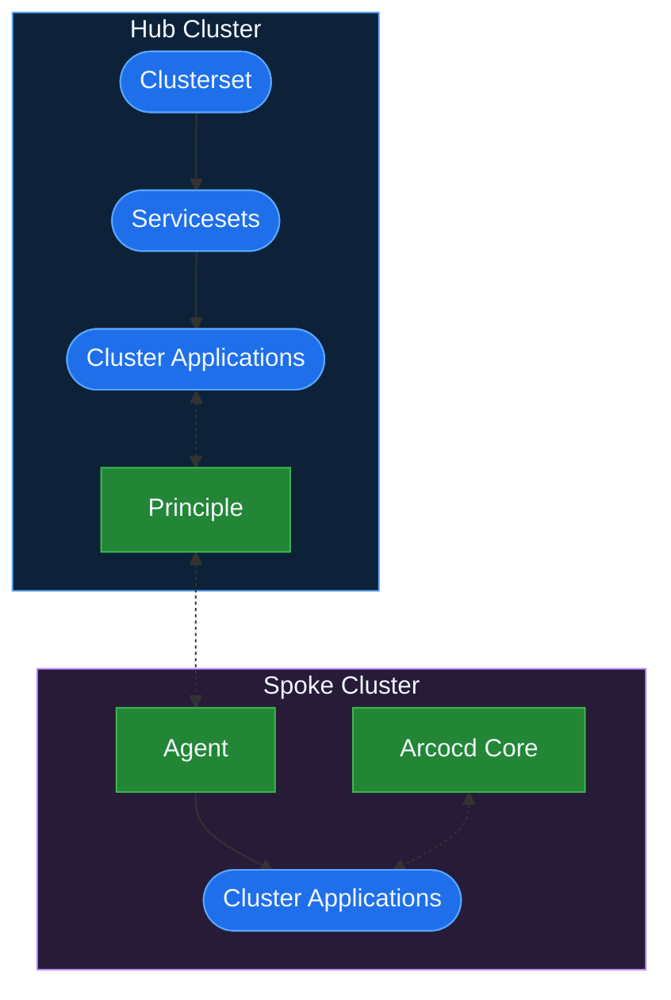

# Argocd Agent Example
Argocd agent is recommended if you manage a high amount of clusters. Application manifests are replicated from the hub cluster to the spoke cluster and deployed by an argocd instance in the spoke cluster. Argo-Flavors can work well with it, all you have to do is set up the agent and principle components and apply a label to your apps. Only the final apps are replicated as shown in this diagram:


# Environment setup
login to your k8s cluster. This example was deployed on microk8s but it is agnostic to the type of cluster.

## Requirements
- vcluster cli
- argocd-agentctl
- kubectl

### create vclusters
create vclusters and set up portforwarding.

create principal (wait patiently for vcluster):
```shell
vcluster disconnect #just in case
MAIN_CTX=`kubectl config current-context`
PRINCIPAL_NAME=principal
PRINCIPAL_CLUSTER_NS=vcluster-$PRINCIPAL_NAME
AGENT_REALESE=v0.8.1
ARGOCD_VERSION=v3.4.1

vcluster create --context $MAIN_CTX $PRINCIPAL_NAME -n $PRINCIPAL_CLUSTER_NS --connect=false --upgrade \
  --set networking.replicateServices.toHost[0].from="argocd/argocd-server" \
  --set networking.replicateServices.toHost[0].to="argocd-server" \
  --set networking.replicateServices.toHost[1].from="argocd/argocd-agent-principal" \
  --set networking.replicateServices.toHost[1].to="argocd-agent-principal"

# set up context variable and background connection
PRINCIPAL_CONTEXT=`vcluster connect $PRINCIPAL_NAME -s -- kubectl config current-context`
vcluster connect --context $MAIN_CTX $PRINCIPAL_NAME --background-proxy=false -s &
```
create agents (wait patiently for vcluster):
```shell
AGENT_NAMES=(agent0 agent1)
AGENT_CONTEXTS=()
for AGENT_NAME in ${AGENT_NAMES[@]}; do
  AGENT_CLUSTER_NS=vcluster-$AGENT_NAME

  vcluster create --context $MAIN_CTX $AGENT_NAME -n $AGENT_CLUSTER_NS --connect=false --upgrade \
    --set networking.replicateServices.fromHost[0].from="$PRINCIPAL_CLUSTER_NS/argocd-agent-principal" \
    --set networking.replicateServices.fromHost[0].to="argocd/argocd-agent-principal"
  
  AGENT_CONTEXTS+=(`vcluster connect $AGENT_NAME -s -- kubectl config current-context`)
  vcluster connect --context $MAIN_CTX $AGENT_NAME --background-proxy=false -s &
done
```

### create principal components
principal needs to be set up with full argocd, so manifests from argocd repo are applied along with the kustomize of argocd-agent:
```shell
kubectl create ns argocd --context $PRINCIPAL_CONTEXT

kubectl apply -n argocd --server-side --force-conflicts --context $PRINCIPAL_CONTEXT \
  -f https://raw.githubusercontent.com/argoproj/argo-cd/$ARGOCD_VERSION/manifests/install.yaml

kubectl patch configmap argocd-cmd-params-cm -n argocd --type merge --context $PRINCIPAL_CONTEXT \
  -p '{"data":{"redis.server":"argocd-agent-redis-proxy:6379"}}'

kubectl rollout restart -n argocd deployment/argocd-server --context $PRINCIPAL_CONTEXT

kubectl apply -n argocd --context $PRINCIPAL_CONTEXT \
  -k "https://github.com/argoproj-labs/argocd-agent/install/kubernetes/principal?ref=$AGENT_REALESE"
```

create principal pki:
```shell
argocd-agentctl pki init \
  --principal-namespace argocd \
  --principal-context $PRINCIPAL_CONTEXT

argocd-agentctl pki issue principal \
  --principal-context $PRINCIPAL_CONTEXT \
  --principal-namespace argocd \
  --dns localhost,argocd-agent-principal.argocd.svc.cluster.local \
  --upsert

argocd-agentctl pki issue resource-proxy \
  --principal-context $PRINCIPAL_CONTEXT \
  --principal-namespace argocd \
  --dns localhost,argocd-agent-resource-proxy.argocd.svc.cluster.local \
  --upsert

argocd-agentctl jwt create-key \
  --principal-context $PRINCIPAL_CONTEXT \
  --principal-namespace argocd \
  --upsert
```
create principal manifests:
```shell
kubectl apply -n argocd --context $PRINCIPAL_CONTEXT \
  -k "https://github.com/argoproj-labs/argocd-agent/install/kubernetes/principal?ref=$AGENT_REALESE"

cat << EOF | kubectl apply -f - --context $PRINCIPAL_CONTEXT
apiVersion: argoproj.io/v1alpha1
kind: AppProject
metadata:
  name: agent-default
  namespace: argocd
  labels:
    edge: "true"
spec:
  clusterResourceWhitelist:
  - group: '*'
    kind: '*'
  destinations:
  - namespace: '*'
    server: '*'
  sourceRepos:
  - '*'
  sourceNamespaces:
  - '*'
EOF

kubectl patch configmap argocd-agent-params -n argocd --context $PRINCIPAL_CONTEXT \
  --patch "{\"data\":{
    \"principal.listen.host\": \"0.0.0.0\",
    \"principal.destination-based-mapping\": \"true\",
    \"agent.server.port\":\"443\",
    \"principal.redis.tls.insecure\": \"true\",
    \"principal.label-selector\": \"edge=true\",
    \"principal.allowed-namespaces\": \"*\"
  }}"
# Remove redis tls mounting
kubectl patch deployment argocd-agent-principal --type=json -n argocd \
  --context $PRINCIPAL_CONTEXT \
  -p="[{'op': 'remove', 'path': '/spec/template/spec/containers/0/volumeMounts/2'}]"
kubectl patch deployment argocd-agent-principal --type=json -n argocd \
  --context $PRINCIPAL_CONTEXT \
  -p="[{'op': 'remove', 'path': '/spec/template/spec/containers/0/volumeMounts/2'}]"
kubectl patch deployment argocd-agent-principal --type=json -n argocd \
   --context $PRINCIPAL_CONTEXT \
  -p="[{'op': 'remove', 'path': '/spec/template/spec/volumes/2'}]"
kubectl patch deployment argocd-agent-principal --type=json -n argocd \
   --context $PRINCIPAL_CONTEXT \
  -p="[{'op': 'remove', 'path': '/spec/template/spec/volumes/2'}]"
```
create agents cluster secrets:
```shell
for AGENT_NAME in ${AGENT_NAMES[@]}; do
  argocd-agentctl agent create $AGENT_NAME \
    --principal-context $PRINCIPAL_CONTEXT \
    --principal-namespace argocd \
    --resource-proxy-server argocd-agent-resource-proxy.argocd.svc.cluster.local:9090
done
```

### create agent components
create argocds:
```shell
for CONTEXT in ${AGENT_CONTEXTS[@]}; do
  kubectl create ns argocd --context $CONTEXT
  kubectl apply -n argocd --context $CONTEXT \
    -k "https://github.com/argoproj-labs/argocd-agent/install/kubernetes/argo-cd/agent-managed?ref=$AGENT_REALESE"
done
```

create agents pki:
```shell
for i in ${!AGENT_NAMES[@]}; do
  AGENT_NAME=${AGENT_NAMES[$i]}
  AGENT_CONTEXT=${AGENT_CONTEXTS[$i]}

  argocd-agentctl pki issue agent $AGENT_NAME \
    --principal-context $PRINCIPAL_CONTEXT \
    --agent-context $AGENT_CONTEXT \
    --agent-namespace argocd \
    --upsert

  argocd-agentctl pki propagate \
    --principal-context $PRINCIPAL_CONTEXT \
    --principal-namespace argocd \
    --agent-context $AGENT_CONTEXT \
    --agent-namespace argocd
done
```

create agent manifests:
```shell
for AGENT_CONTEXT in ${AGENT_CONTEXTS[@]}; do
kubectl apply -n argocd \
  -k "https://github.com/argoproj-labs/argocd-agent/install/kubernetes/agent?ref=$AGENT_REALESE" \
  --context $AGENT_CONTEXT

kubectl patch configmap argocd-agent-params -n argocd --context $AGENT_CONTEXT \
  --patch "{\"data\":{
    \"agent.server.address\":\"argocd-agent-principal.argocd.svc.cluster.local\",
    \"agent.server.port\":\"443\",
    \"agent.mode\":\"managed\",
    \"agent.creds\":\"mtls:any\",
    \"agent.redis.tls.insecure\":\"true\",
    \"agent.destination-based-mapping\":\"true\",
    \"agent.label-selector\": \"edge=true\",
    \"agent.allowed-namespaces\": \"*\"
  }}"

kubectl rollout restart deployment argocd-agent-agent -n argocd --context $AGENT_CONTEXT

#Create view clusterRoleBinding
#Create default AppProject
cat << EOF | kubectl apply -f - --context $AGENT_CONTEXT
apiVersion: rbac.authorization.k8s.io/v1
kind: ClusterRoleBinding
metadata:
  name: argocd-agent-agent-view
roleRef:
  apiGroup: rbac.authorization.k8s.io
  kind: ClusterRole
  name: view
subjects:
- kind: ServiceAccount
  name: argocd-agent-agent
  namespace: argocd
EOF
done
```

### Test connection
Get the initial argocd admin password:
```shell
kubectl -n argocd get secret argocd-initial-admin-secret -o jsonpath="{.data.password}" --context $PRINCIPAL_CONTEXT | base64 -d && echo
```
Expose the argocd-server svc however you want to or use port-forwarding:
```shell
kubectl port-forward svc/argocd-server --context $MAIN_CTX -n $PRINCIPAL_CLUSTER_NS 9999:80
# Access at localhost:9999
```
you can verify the agent by deploying an app to the principal:
```shell
cat << EOF | kubectl apply -f - --context $PRINCIPAL_CONTEXT
apiVersion: argoproj.io/v1alpha1
kind: Application
metadata:
  name: test-app
  namespace: argocd
  labels:
    edge: "true"
spec:
  project: agent-default
  source:
    repoURL: https://github.com/argoproj/argocd-example-apps
    targetRevision: HEAD
    path: guestbook
  destination:
    name: ${AGENT_NAMES[0]}
    namespace: guestbook
  syncPolicy:
    syncOptions:
    - CreateNamespace=true
EOF
```

# Deploy Flavors
This directory has some simple definitions with two agent clusters and two apps per cluster. Deploy the following manifest to test your agents and see the deployment in action:

```shell
cat << EOF | kubectl apply -f - --context $PRINCIPAL_CONTEXT
apiVersion: argoproj.io/v1alpha1
kind: Application
metadata:
  name: clusterset-prod-argo-agent
  namespace: argocd
  labels:
    type: clusterset
spec:
  destination:
    server: https://kubernetes.default.svc
    namespace: argocd
  project: default
  source:
    helm:
      parameters:
      - name: definitionsRepo.repoURL
        value: https://github.com/poxelyric/argo-flavors.git
      - name: definitionsRepo.targetRevision
        value: HEAD
      - name: definitionsRepo.basePath
        value: example-definitions/argocd-agent
      - name: env
        value: prod
    chart: clusterset
    repoURL: ghcr.io/poxelyric
    targetRevision: 1.0.0
EOF
```