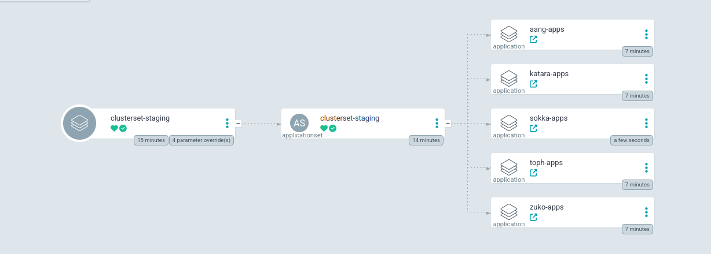
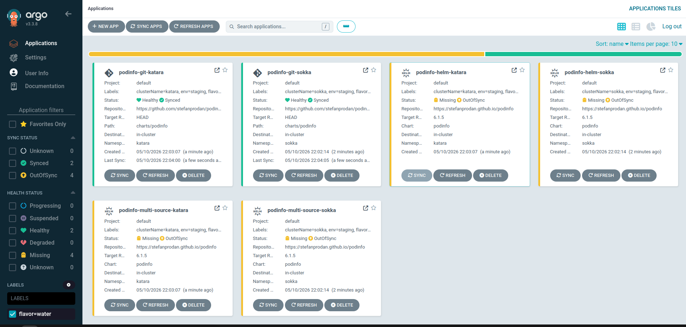
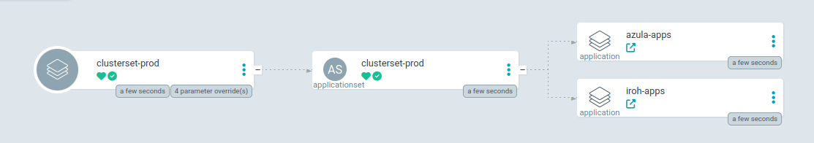
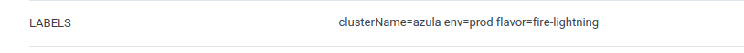

# avatar example definitions

This example is intentionally focused on patching an existing app definition using the same app name across multiple levels.

# NOTE
This example doesn't deploy to remote clusters in order to simplify getting started. You can edit the `defaults` field in the root `_apps.yaml` file in order to template a url or name for destination:
```yml
defaults:
  spec:
    destination:
      server: "https://{{ .Values.clusterName }}.example.com"
```

## Requirements
- a working argocd instance

## Deploy clusterset
```bash
cat << EOF | kubectl apply -f - -n argocd
apiVersion: argoproj.io/v1alpha1
kind: Application
metadata:
  name: clusterset-staging
  labels:
    type: clusterset
spec:
  destination:
    server: https://kubernetes.default.svc
  project: default
  source:
    helm:
      parameters:
      - name: definitionsRepo.repoURL
        value:https://github.com/poxelyric/argo-flavors.git
      - name: definitionsRepo.targetRevision
        value: HEAD
      - name: definitionsRepo.basePath
        value: example-definitions/avatar
    path: clusterset
    repoURL: https://github.com/poxelyric/argo-flavors.git
    targetRevision: HEAD
```

Login to the argocd UI and sync the app. You should see an applicationset being created which will create four differet apps.
<p align="center">
    
</p>

## Explore cluster applications
Enter sokka-apps application and sync it.

you can filter applications based on flavor by a label which is automatically added. see bottom left:
<p align="center">
    
</p>

You can see how this label is added by going to [serviceset values](../../serviceset/values.yaml) and looking at `defaults` key.

### Removed app

Go into zuko apps. There are only two of them, unlike the other flavors. This is because fire flavor [removes one of the apps](fire/_apps.yaml)

## Deploy Prod
```shell
cat << EOF | kubectl apply -f - -n argocd
apiVersion: argoproj.io/v1alpha1
kind: Application
metadata:
  name: clusterset-prod
  labels:
    type: clusterset
spec:
  destination:
    server: https://kubernetes.default.svc
    namespace: argocd
  project: default
  source:
    helm:
      parameters:
      - name: definitionsRepo.repoURL
        value: https://github.com/poxelyric/argo-flavors.git
      - name: definitionsRepo.targetRevision
        value: HEAD
      - name: definitionsRepo.basePath
        value: example-definitions/avatar
      - name: env
        value: prod
    path: clusterset
    repoURL: https://github.com/poxelyric/argo-flavors.git
    targetRevision: HEAD
EOF
```
You can see that only azula and iroh were deployed. This is because they are the only clusters under a directory named prod.

<p align="center">
    
</p>

Sync azula's applications and look at their labels. The flavor label is different than iroh and zuko, this is because azula is in a sub flavor of lightning.
<p align="center">
    
</p>

## What is demonstrated

- Root level defines the base set of apps in `example-definitions/avatar/_apps.yaml`.
- Flavor-level files modify the same app names from the root.
- Environment-level `_apps.yaml` files are kept empty to keep the demo simple.
- Cluster files still have the highest precedence and can make the final, cluster-specific patch.

## Root apps

The [root file](_apps.yaml) defines three apps:

- `podinfo-helm` (Helm repo chart)
- `podinfo-git` (Git repo chart path)
- `podinfo-multi-source` (multiple `sources:` entries)

## Flavor patching

- Earth flavor patches `podinfo-helm` for the Earth Kingdom.
- Fire flavor patches `podinfo-helm` for the Fire Nation and removes `podinfo-git`.
- Water and Wind flavors patch `podinfo-helm` with their own messages.
- `fire/lightning` is a subflavor of Fire that inherits Fire behavior and adds lightning-specific capabilities.

## Environment and cluster precedence

This demo uses a small set of files so users can see the layering without overload:

1. `example-definitions/avatar/_apps.yaml`
2. `example-definitions/avatar/<flavor>/_apps.yaml`
3. `example-definitions/avatar/<flavor>/<env>/_apps.yaml`
4. `example-definitions/avatar/<flavor>/<env>/<cluster>.yaml`
