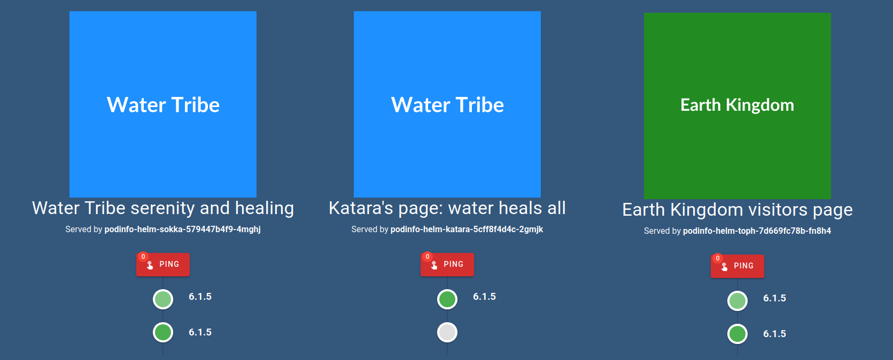
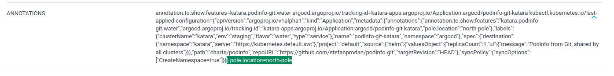

# Avatar Example Definitions

This example is intentionally focused on patching an existing app definition using the same app name across multiple levels.

> [!NOTE]
> This example doesn't deploy to remote clusters in order to simplify getting started. You can edit the `defaults` field in the root `_apps.yaml` file in order to template a url or name for destination:
> ```yml
> defaults:
>   spec:
>     destination:
>       server: "https://{{ .Values.clusterName }}.example.com"
> ```

## Requirements
- a working argocd instance

## Deploy Staging Clusterset
```shell
cat << EOF | kubectl apply -f - -n argocd
apiVersion: argoproj.io/v1alpha1
kind: Application
metadata:
  name: clusterset-staging
  labels:
    type: clusterset
spec:
  destination:
    server: "https://kubernetes.default.svc"
  project: default
  source:
    helm:
      parameters:
      - name: definitionsRepo.repoURL
        value: "https://github.com/poxelyric/argo-flavors.git"
      - name: definitionsRepo.targetRevision
        value: HEAD
      - name: definitionsRepo.basePath
        value: example-definitions/avatar
    chart: clusterset
    repoURL: ghcr.io/poxelyric
    targetRevision: 1.0.0
EOF
```

Login to the argocd UI and sync the app. You should see an applicationset being created which will create five differet apps.
<p align="center">
    
</p>

## Explore Cluster Applications
Sync the applications. As you can see the same apps are deployed across these clusters with slight variations. The podinfo-helm app is a little different every time but the guestbook app is not patched and so it is the same across all clusters. Every app has the cluster name as a suffix to avoid conflicts.

you can filter applications based on flavor by a label which is automatically added. see bottom left:
<p align="center">
    
</p>

You can see how this label is added by going to [serviceset values](../../serviceset/values.yaml) and looking at `defaults` key.

### Removed app

Go into zuko apps. There are only two of them, unlike the other flavors. This is because fire flavor [removes one of the apps](fire/_apps.yaml)

### Different spec

If you look at the landing pages of the podinfo-helm app you can see the effect of patching its values. Here are the landing pages of toph sokka and katara:
<p align="center">
    
</p>

See how both katara and sokka have the same image? That is because we applied that change in the flavor level [here](water/_apps.yaml). Katara has a change at the [cluster level](water/staging/katara.yaml) and so her title shows a uniqe message.

### Defaults
Examine the water tribe apps. They all have an annotation `pole.location`. This is done through the defaults field in the [water _apps.yaml](water/_apps.yaml). We only had to specify this setting once.

<p align="center">
    
</p>


### Templating
As you can see every app is deployed into a namespace of the cluster name. This is achieved through the defaults field and dynamic templating in the main [_apps.yaml](_apps.yaml). See [advanced usage](/docs/advanced-usage.md) for more information.


## Deploy Prod Clusterset
```shell
cat << EOF | kubectl apply -f - -n argocd
apiVersion: argoproj.io/v1alpha1
kind: Application
metadata:
  name: clusterset-prod
  labels:
    type: clusterset
spec:
  destination:
    server: "https://kubernetes.default.svc"
    namespace: argocd
  project: default
  source:
    helm:
      parameters:
      - name: definitionsRepo.repoURL
        value: "https://github.com/poxelyric/argo-flavors.git"
      - name: definitionsRepo.targetRevision
        value: HEAD
      - name: definitionsRepo.basePath
        value: example-definitions/avatar
      - name: env
        value: prod
    chart: clusterset
    repoURL: ghcr.io/poxelyric
    targetRevision: 1.0.0
EOF
```
You can see that only azula and iroh were deployed. This is because they are the only clusters under a directory named prod.

<p align="center">
    
</p>

Sync azula's applications and look at their labels. The flavor label is different than iroh and zuko, this is because azula is in a sub flavor of lightning.
<p align="center">
    
</p>
